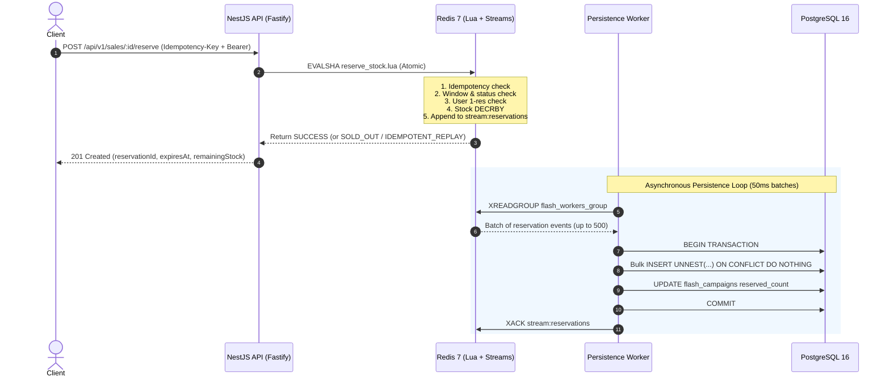

# FlashReserve: High-Concurrency Flash-Sale & Inventory Reservation Engine

[](https://www.typescriptlang.org/)
[](https://nestjs.com/)
[](https://fastify.dev/)
[](https://www.postgresql.org/)
[](https://redis.io/)

FlashReserve is an enterprise-grade, high-throughput flash-sale and inventory reservation engine built with **NestJS**, **Fastify**, **Redis 7 (Lua scripting + Streams)**, and **PostgreSQL 16**.

It is architected specifically to handle traffic surges of **10,000–20,000 requests/sec** with **sub-2.5ms P95 latency** on the hot write path without overselling, deadlocks, or inventory drift.

---

## 1. Monorepo Structure

```
FlashReserve/
├── apps/
│   ├── backend/          # NestJS Fastify backend (Redis Lua, Streams, Aiven PostgreSQL, PASETO)
│   └── frontend/         # Storefront & Admin frontend applications
├── packages/
│   └── shared-types/     # Shared TypeScript interfaces, DTOs, and contracts
├── package.json          # Root workspace scripts & dependencies
└── turbo.json            # Turborepo task pipelines
```

---

## 2. Architectural Highlights

- **Dual Application Modes**: A modular monolith running either as HTTP API (`APP_MODE=api`) or background persistence worker (`APP_MODE=worker`) from a single codebase.
- **Atomic Lua Allocation**: All reservation checks (stock, active window, per-user limits, idempotency) execute inside a preloaded Redis Lua script (`EVALSHA` with automatic `NOSCRIPT` recovery).
- **Zero PostgreSQL Contention on Writes**: The API tier never acquires database row locks during reservations. Events are appended to `stream:reservations`.
- **Vectorized Ingestion via PostgreSQL `UNNEST`**: The worker ingests up to 500 events per batch inside a single PostgreSQL transaction using parameterized `UNNEST` queries with `ON CONFLICT` handling.
- **Dual-Store Read Reconciliation**: `GET /api/v1/reservations/:resId` checks PostgreSQL first, falling back to the Redis buffer to return `ACCEPTED`, `RESERVED`, `PAID`, or `EXPIRED`.
- **Race-Proof Expiration & Checkout**: Mutual exclusion between payment confirmation and expiration is enforced via conditional SQL row updates (`WHERE id = $1 AND status = 'RESERVED'`).



---

## 3. Quick Start (Local Development)

### Install dependencies
```powershell
npm install --legacy-peer-deps
```

### Run Backend Tests
```powershell
npm run backend:test
```

### Start API in Dev Mode
```powershell
npm run backend:dev
```
