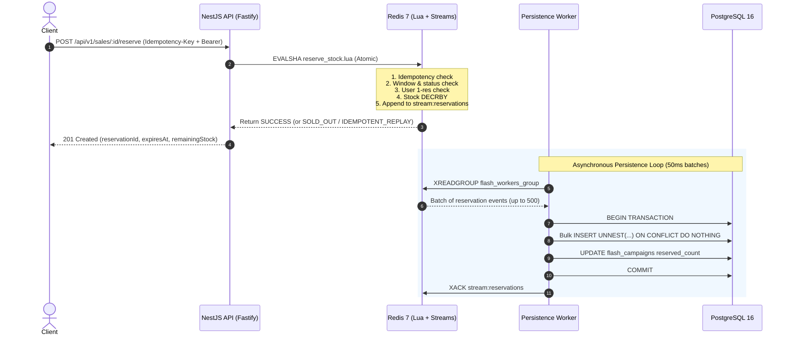

# FlashReserve: High-Concurrency Flash-Sale & Inventory Reservation Engine

[](https://www.typescriptlang.org/)
[](https://nestjs.com/)
[](https://fastify.dev/)
[](https://www.postgresql.org/)
[](https://redis.io/)

FlashReserve is an enterprise-grade, high-throughput flash-sale and inventory reservation engine built with **NestJS**, **Fastify**, **Redis 7 (Lua scripting + Streams)**, and **PostgreSQL 16**.

It is architected specifically to handle traffic surges of **10,000–20,000 requests/sec** with **sub-2.5ms P95 latency** on the hot write path without overselling, deadlocks, or inventory drift.

---

## 1. Architectural Highlights

- **Dual Application Modes**: A modular monolith running either as HTTP API (`APP_MODE=api`) or background persistence worker (`APP_MODE=worker`) from a single codebase.
- **Atomic Lua Allocation**: All reservation checks (stock, active window, per-user limits, idempotency) execute inside a preloaded Redis Lua script (`EVALSHA` with automatic `NOSCRIPT` recovery).
- **Zero PostgreSQL Contention on Writes**: The API tier never acquires database row locks during reservations. Events are appended to `stream:reservations`.
- **Vectorized Ingestion via PostgreSQL `UNNEST`**: The worker ingests up to 500 events per batch inside a single PostgreSQL transaction using parameterized `UNNEST` queries with `ON CONFLICT` handling.
- **Dual-Store Read Reconciliation**: `GET /api/v1/reservations/:resId` checks PostgreSQL first, falling back to the Redis buffer to return `ACCEPTED`, `RESERVED`, `PAID`, or `EXPIRED`.
- **Race-Proof Expiration & Checkout**: Mutual exclusion between payment confirmation and expiration is enforced via conditional SQL row updates (`WHERE id = $1 AND status = 'RESERVED'`).



---

## 2. Redis Key Topology & Hash-Tagging

All campaign-scoped keys use Redis Cluster hash-tags `{campaignId}` to guarantee multi-key Lua atomicity on a single shard:

| Key Pattern | Type | TTL | Purpose |
| :--- | :--- | :--- | :--- |
| `flash:stock:{<campaignId>}` | String | None | Atomic available inventory counter |
| `flash:meta:{<campaignId>}` | Hash | None | Campaign status (`isActive`), window (`startsAt`, `endsAt`) |
| `flash:user:{<campaignId>}:<userId>` | String | `RESERVATION_TTL` | Enforces 1 reservation per user per campaign |
| `flash:res:{<campaignId>}:<resId>` | Hash | `RESERVATION_TTL` | In-memory reservation buffer |
| `flash:idem:{<campaignId>}:<idemKey>` | Hash | `RESERVATION_TTL` | Payload hash and deterministic response replay |
| `stream:reservations` | Stream | Unbounded | Event stream consumed by worker consumer group |

---

## 3. Database Schema

Managed via versioned SQL migrations in `src/database/migrations/`:

### `flash_campaigns`
- `id VARCHAR(64) PRIMARY KEY`
- `title VARCHAR(180) NOT NULL`
- `price_cents INTEGER NOT NULL CHECK (price_cents >= 0)`
- `total_inventory INTEGER NOT NULL CHECK (total_inventory >= 0)`
- `reserved_count INTEGER NOT NULL DEFAULT 0 CHECK (reserved_count <= total_inventory)`
- `version BIGINT NOT NULL DEFAULT 1`
- `starts_at TIMESTAMPTZ NOT NULL`
- `ends_at TIMESTAMPTZ NOT NULL CHECK (ends_at > starts_at)`
- `created_at / updated_at TIMESTAMPTZ DEFAULT NOW()`

### `reservations`
- `id VARCHAR(36) PRIMARY KEY` (ULID)
- `campaign_id VARCHAR(64) REFERENCES flash_campaigns(id)`
- `user_id VARCHAR(64) NOT NULL`
- `quantity SMALLINT NOT NULL CHECK (quantity > 0)`
- `status VARCHAR(24) NOT NULL CHECK (status IN ('RESERVED', 'PAID', 'EXPIRED', 'CANCELLED'))`
- `expires_at TIMESTAMPTZ NOT NULL`
- `created_at / db_synced_at TIMESTAMPTZ DEFAULT NOW()`
- `db_tx_version BIGINT DEFAULT 1`
- `CONSTRAINT uq_campaign_user UNIQUE (campaign_id, user_id)`
- Partial Index: `CREATE INDEX ... ON reservations (status, expires_at) WHERE status = 'RESERVED'`

---

## 4. Quick Start (Local Development)

### Prerequisites
- Node.js 22+
- Docker & Docker Compose (optional for containerized runtime)
- Local PostgreSQL 16 & Redis 7 (or via Docker)

### Option A: Docker Compose (All-in-One)

```powershell
# 1. Start PostgreSQL 16, Redis 7, API, and Persistence Worker
docker compose up --build -d

# 2. View logs
docker compose logs -f api
```

### Option B: Local Node.js Development

```powershell
# 1. Install dependencies
npm i --legacy-peer-deps

# 2. Copy environment template
Copy-Item .env.example .env

# 3. Build project
npm run build

# 4. Start API server
npm run start:dev

# 5. In a second terminal, start the persistence worker
$env:APP_MODE="worker"; npm run start:dev
```

---

## 5. API Reference & Verification Examples

### 1. Create a Flash-Sale Campaign (Admin)

```bash
curl -X POST http://localhost:3000/api/v1/campaigns \
  -H "Content-Type: application/json" \
  -H "Authorization: Bearer dev-admin-1" \
  -d '{
    "title": "iPhone 16 Pro Flagship Drop",
    "priceCents": 99900,
    "totalInventory": 1000,
    "startsAt": "2026-10-24T00:00:00.000Z",
    "endsAt": "2026-10-25T23:59:59.000Z"
  }'
```

### 2. Reserve Stock (High-Concurrency Hot Path)

```bash
curl -X POST http://localhost:3000/api/v1/sales/camp_01HNG58J2A9ZX7/reserve \
  -H "Content-Type: application/json" \
  -H "Authorization: Bearer dev-user-1001" \
  -H "Idempotency-Key: 9b1deb4d-3b7d-4bad-9bdd-2b0d7b3dcb6d" \
  -d '{
    "quantity": 1
  }'
```

**Response (201 Created)**:
```json
{
  "reservationId": "01HNG90B6Z4K589T7M01234567",
  "campaignId": "camp_01HNG58J2A9ZX7",
  "userId": "1001",
  "quantity": 1,
  "status": "RESERVED",
  "remainingStock": 999,
  "expiresAt": "2026-10-24T17:40:00.000Z",
  "createdAt": "2026-10-24T17:30:00.000Z",
  "dbSyncedAt": null,
  "dbTxVersion": null
}
```

### 3. Read Reservation (Reconciled)

```bash
curl http://localhost:3000/api/v1/reservations/01HNG90B6Z4K589T7M01234567 \
  -H "Authorization: Bearer dev-user-1001"
```

### 4. Checkout & Payment Confirmation

```bash
curl -X POST http://localhost:3000/api/v1/checkout/01HNG90B6Z4K589T7M01234567/pay \
  -H "Content-Type: application/json" \
  -H "Authorization: Bearer dev-user-1001" \
  -d '{
    "paymentToken": "tok_visa_4242"
  }'
```

### 5. Health & Prometheus Metrics

- **Liveness Probe**: `curl http://localhost:3000/health/live`
- **Readiness Probe**: `curl http://localhost:3000/health/ready`
- **Prometheus Scrape**: `curl http://localhost:3000/metrics`
- **Swagger Documentation**: Open [http://localhost:3000/api](http://localhost:3000/api)

---

## 6. Automated Test Suite

```powershell
# Run unit and invariant tests
npm test

# Run concurrency simulation suite (stock conservation, race exclusion)
npm run test:concurrency

# Run end-to-end integration tests
npm run test:e2e

# Run linter
npm run lint

# Production build verification
npm run build
```

---

## 7. Architecture Decision Records (ADRs)

- [ADR 001: Idempotency Strategy](docs/adr/001-idempotency-strategy.md)
- [ADR 002: Dual-Store Consistency](docs/adr/002-dual-store-consistency.md)
- [ADR 003: Event Delivery & Worker Persistence](docs/adr/003-event-delivery-and-worker-persistence.md)
- [ADR 004: Inventory Recovery & Expiration Race Exclusion](docs/adr/004-inventory-recovery-and-expiration.md)

---

## 8. Benchmark SLA & Performance Targets

| Target Metric | Benchmark Goal | Local Baseline Architecture |
| :--- | :--- | :--- |
| **Hot Path P95 Latency** | `< 2.5 ms` | Evaluated in Redis memory (`EVALSHA`) |
| **Peak Throughput** | `10,000–20,000 req/s` | Non-blocking Fastify + asynchronous Streams |
| **Inventory Drift** | `0 (Exact)` | Single-threaded atomic Redis Lua decrement |
| **Persistence Lag** | `50–120 ms` | 50ms batch window with UNNEST bulk inserts |

Execute load testing via k6:
```bash
k6 run load-tests/reservation-k6.js
```
